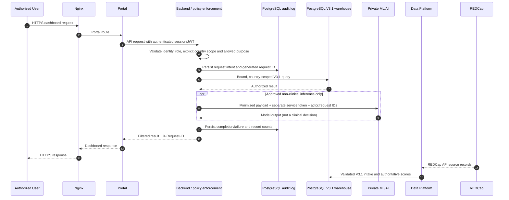
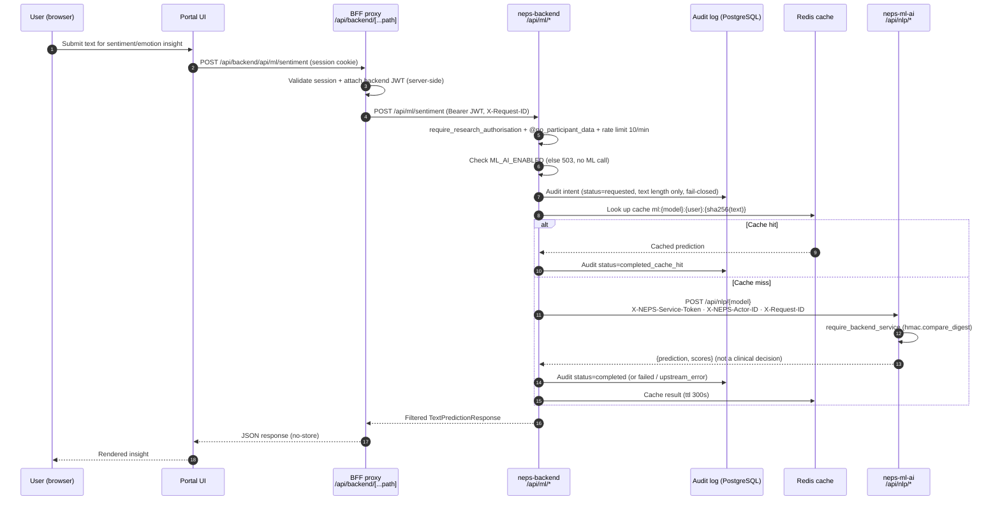
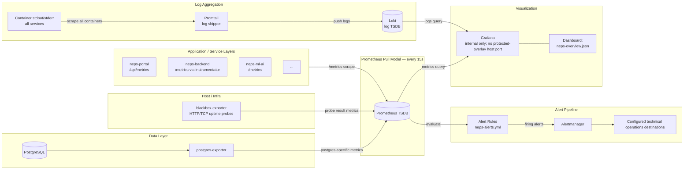

# 06 — Data Flow & System Architecture

**Document Status:** Draft — Current V3.1 Track A boundary recorded; production authorization pending
**Owner:** Damien + Documentation Lead
**Interview Required:** Backend Lead (to verify and fill gaps)
**Priority:** 2 (Foundational — every other doc references this)

---

## 1. Overview

The NEPS Digital System is a research data platform for the NEPS baseline study across Ghana, Sierra Leone, and Tanzania. The current handover supports independent REDCap source receipt and reviewable V3.1 validation/scoring development. Track A dashboards may be built against synthetic fixtures and guarded development APIs, but live research access remains denied until trusted identity and approved purpose/consent/country adapters are implemented and verified. The handover does not authorize portal data entry, longitudinal workflows, clinical thresholds, automated safeguarding alerts, or production deployment.

> **Current ML boundary:** the backend is the only application service that reads
> research data from PostgreSQL. ML/AI is a private, stateless inference service
> with no database credentials, warehouse network, participant-data API, host
> port, or Nginx route. See
> `neps-infrastructure/docs/ML_AI_SECURITY_ARCHITECTURE.md`. Older diagrams and
> operational drafts in this document that describe ML-to-PostgreSQL reads,
> clinical risk predictions, or Discord safeguarding alerts are superseded.
> The image's control flow is otherwise a useful model: authenticate and scope
> at the backend, write intent audit before access, call ML privately only with
> minimized authorized input, then audit completion and filter the response.
> ML must never retrieve records from PostgreSQL.

**Source Diagrams (original):** See `NEPSDigSystem-main/Info Files/`:
- `NEPS Digital - information flow diagram.png`
- `NEPS Digital - On-Prem_Deployment diagram.png`
- `NEPS_Digital_HIgh-level-Component.png`

---

## 2. Overall NEPS Digital System Architecture

This section is the authoritative high-level view of the whole system: the NEPS
repositories, the tiers they occupy, how a request travels from a user's browser
through the backend to data and back, and the trust boundaries that must not be
crossed. Detailed request/response flows follow in
[§4](#4-end-to-end-data-flow-redcap--user); per-service detail lives in the
`README.md` of each repository.

### 2.1 High-Level Component Diagram

```mermaid
graph TB
    subgraph Users[End Users — Ghana / Sierra Leone / Tanzania]
        E[Enumerator<br/>(field worker)]
        CL[Country Lead]
        PI[Principal Investigator]
        W[Welfare responder<br/>(restricted workflow)]
        A[Admin<br/>(technical access not participant access)]
    end

    subgraph Edge[Edge / Public Tier]
        N[Nginx<br/>TLS termination<br/>Security headers]
    end

    subgraph Frontend[Presentation Layer]
        P[neps-portal<br/>Next.js 16 · NextAuth v5<br/>BFF proxy /api/backend/*]
    end

    subgraph Backend[Application Layer]
        B[neps-backend<br/>FastAPI · SQLAlchemy async<br/>Portal + Analytics + Sync routers]
        M[neps-ml-ai<br/>Private stateless inference<br/>disabled pending governance]
    end

    subgraph Data[Data / Integration Layer]
        DP[neps-data-platform<br/>Independent source intake + reviewed processing]
        R[(REDCap<br/>Forms / Surveys<br/>Source of Truth)]
    end

    subgraph Persistence[Persistence Layer]
        PG[(PostgreSQL 15<br/>neps_core schema<br/>PITR WAL)]
        RD[(Redis<br/>Cache · Circuit-breaker)]
        MO[(MinIO<br/>S3-compatible backup target)]
    end

    subgraph Observability[Monitoring / Observability]
        PR[Prometheus<br/>Metrics · Alert rules]
        GF[Grafana<br/>Dashboards · Logs]
        AM[Alertmanager<br/>technical operations only]
        LK[Loki + Promtail<br/>Log aggregation]
        OF[Ofelia<br/>Cron: ETL + PITR backup]
    end

    subgraph Docs[Documentation]
        D[neps-docs<br/>This repo · 9 numbered documents]
    end

    %% User → Edge → Frontend
    E & CL & PI & W & A -->|HTTPS :443| N
    N -->|/ route| P

    %% Frontend → Backend
    P -->|BFF proxy /api/backend/*<br/>session token attached server-side| B
    B -->|Private service token + request ID<br/>only when explicitly enabled| M

    %% Data layer
    R <-->|REDCap API| DP
    DP -->|Upsert| PG
    B <-->|Read · Write| PG
    B <-->|Cache| RD
    B -->|REDCap proxy| R

    %% Backup
    PG -->|WAL + Base backup| MO
    OF -->|cron 01:00| DP
    OF -->|cron 02:00| PG

    %% Observability
    P & B & M & DP & PG & RD -.->|/metrics scraping| PR
    P & B & M & DP & PG -.->|Logs| LK
    PR -->|Alert rules| AM
    AM -->|Configured technical alerts only| OPS[/Operations alert sink/]
    PR & LK --> GF

    %% Docs reference all
    D -. reference .-> Users & Edge & Frontend & Backend & Data & Persistence & Observability
```

> **Edge routing caveat (verify before deploy).** Nginx routes `location /api/`
> directly to `neps-backend`, while the portal's BFF proxy is served by
> `neps-portal` under `/api/backend/...`. Because `/api/backend/...` also matches
> the `/api/` prefix, the BFF route can be **shadowed by Nginx** in the composed
> stack — browser calls to `/api/backend/...` would reach the backend unproxied
> instead of the portal's token-injecting handler. Resolve with a more specific
> `location /api/backend/` → portal (or a distinct browser-only prefix). Local
> `npm run dev` (no Nginx) is unaffected. See `neps-portal/README.md §11`.

### 2.2 Repository & Tier Responsibilities

| # | Repository | Technology | Purpose |
|---|------------|-----------|---------|
| 1 | `neps-infrastructure` | Docker Compose, Nginx, Prometheus, Grafana, Alertmanager, Ofelia | Orchestrates all services, networking, monitoring, backups, scheduling |
| 2 | `neps-backend` | FastAPI (Python 3.11), SQLAlchemy async, PostgreSQL, Redis, APScheduler | Core API — Portal endpoints, Analytics endpoints, REDCap sync, auth scaffolding |
| 3 | `neps-portal` | Next.js 16, TypeScript, TailwindCSS, NextAuth.js (v5), Recharts | Dashboard UI + BFF proxy; frontend role visibility is not authorization |
| 4 | `neps-data-platform` | Python ETL, Alembic, structlog, pandas, SQLAlchemy | REDCap → PostgreSQL ETL pipeline (extract, transform, normalize, load) |
| 5 | `neps-ml-ai` | FastAPI, scikit-learn, NLTK/spaCy, PKL serialised models | Private stateless NLP inference; no warehouse access; inference disabled pending governance approval |
| 6 | `neps-docs` | Markdown | Documentation repository (this repo) |

### 2.3 Trust Boundaries (Must Not Be Crossed)

| Boundary | Rule |
|----------|------|
| Browser → Backend | The portal is a presentation tier only. It may call the backend, but every request is authorized independently at the backend; hidden controls, role labels, and country selectors are not security controls. |
| Portal → Backend credential | The backend JWT is attached server-side by the BFF proxy (`/api/backend/[...path]`) and is never exposed to browser code. |
| Backend → PostgreSQL | The backend is the only application service that reads research data from PostgreSQL. |
| Backend → ML/AI | The backend is the only path to ML/AI. It authenticates the human, audits intent/completion, and forwards a minimized payload with a separate service token — never the user's JWT. |
| ML/AI → PostgreSQL | Forbidden. ML/AI has no database credentials, database network, dataset endpoint, host port, or Nginx route. |
| Data Platform → PostgreSQL | Permitted. The Data Platform is the sole producer of V3.1 scores; it writes validated intake and authoritative scores. |

---

## 3. Infrastructure Stack (Docker Compose Services)

Services are defined in `neps-infrastructure/docker-compose.yml` with development and staging overlays. The existence of deployment overlays is not production authorization.

### 3.1 Networking — 4-Tier Isolation

```mermaid
graph LR
    subgraph HOST[KNUST On-Prem Server Host]
        subgraph PUBLIC[neps-public network]
            direction LR
            N[Nginx :80 :443<br/>Only public ingress]
        end

        subgraph INTERNAL[neps-internal network]
            direction TB
            NP[neps-portal :3000]
            NB[neps-backend :8000]
            NML[neps-ml-ai :8000]
            NDP[neps-data-platform<br/>(no HTTP — exec'd)]
            R[Redis :6379]
            OF[Ofelia scheduler]
            PgA[PgAdmin :80]
            MI[MinIO :9000 :9001]
            BB[Blackbox exporter :9115]
        end

        subgraph MONITORING[neps-monitoring network]
            direction TB
            PR[Prometheus :9090]
            GF[Grafana :3000]
            AM[Alertmanager :9093]
            LK[Loki :3100]
            PT[Promtail<br/>(no port)]
        end

        subgraph DATABASE[neps-database network — fully isolated]
            direction TB
            PG[(PostgreSQL :5432)]
            PE[Postgres exporter :9187]
        end
    end

    %% Internet -> Nginx (only public entrypoint)
    INTERNET([Internet<br/>Field teams / Researchers]) -->|HTTPS 443| N

    %% Nginx proxies to internal
    N -->|proxy_pass| NP
    N -->|proxy_pass /api| NB
    N -->|proxy_pass| GF
    N -->|proxy_pass| PgA

    %% Only approved data services may access PostgreSQL
    NB -->|TCP 5432| PG
    NDP -->|TCP 5432| PG
    PgA -->|TCP 5432| PG
    PE -->|metrics scrape| PG
    NB -->|Private inference request; no DB access| NML

    %% Internal service -> Redis
    NB --> R

    %% Ofelia schedules ETL + backup
    OF -->|docker exec cron 01:00| NDP
    OF -->|pg_basebackup cron 02:00| PG

    %% Monitoring scrapes everything via host DNS
    PR ---|scrape /metrics| NB & NP & NML & PG & PE & BB
    PR ---|scrape /metrics| R & MI
    PR --> AM
    PT -->|ship container logs| LK
    PR & LK --> GF
    AM -->|technical operations only| OPS[/Configured operations sink/]

    %% Observability shares connection with internal
    INTERNAL <-->|prometheus scrape| MONITORING
```

| Network | Scope | Services Connected |
|---------|-------|-------------------|
| `neps-public` | Edge-facing network | nginx and only the explicitly configured edge-facing services |
| `neps-internal` | Service-to-service (internal only) | neps-backend, neps-portal, neps-ml-ai, neps-data-platform, redis, ofelia, blackbox-exporter, prometheus, alertmanager, grafana, loki, promtail, pgadmin, minio |
| `neps-database` | Isolated database tier | backend, data platform, postgres, postgres-exporter, and approved administration services; ML/AI is excluded |
| `neps-monitoring` | Metrics/logging aggregation | prometheus, grafana, alertmanager, loki, exporters |

Only explicitly configured ingress should be public. Published development,
administration, and monitoring ports require host/network restrictions;
container-network membership alone is not production authorization.

### 3.2 Service Inventory

The host-port columns below describe the protected production/staging Compose
overlays, not local development. In those overlays only Nginx is published;
operations and administration services require an explicitly approved private
operator access path.

| Service | Image/Base | Port (internal) | Port (host prod) | Port (host staging) | Purpose |
|---------|-----------|-----------------|------------------|---------------------|---------|
| `postgres` | postgres:15-alpine | 5432 | — | — | Primary DB (neps_core schema) |
| `redis` | redis:7-alpine | 6379 | — | — | Session/cache/circuit-breaker state |
| `neps-backend` | python:3.11-alpine | 8000 | — | — | FastAPI application |
| `neps-portal` | node:22-slim | 3000 | — | — | Next.js frontend |
| `neps-ml-ai` | python:3.11-slim | 8000 | — | — | Private, stateless NLP inference; service-token protected; no warehouse access |
| `neps-data-platform` | python:3.11-slim | (no HTTP) | — | — | ETL container (Ofelia exec's into it) |
| `nginx` | nginx:1.27-alpine | 80/443 | 80/443 | 18080/18443 | Reverse proxy + TLS termination |
| `prometheus` | prom/prometheus | 9090 | — | — | Metrics scraping + alert evaluation |
| `grafana` | grafana/grafana | 3000 | — | — | Internal dashboards + log viewer |
| `alertmanager` | prom/alertmanager | 9093 | — | — | Technical operations alert routing only |
| `loki` | grafana/loki | 3100 | — | — | Log aggregation |
| `promtail` | grafana/promtail | — | — | — | Container log shipper → Loki |
| `ofelia` | mcuadros/ofelia | — | — | — | Cron scheduler (ETL sync 01:00, PITR backup 02:00) |
| `pgadmin` | dpage/pgadmin4 | 80 | — | — | Internal DB admin UI |
| `minio` | minio/minio | 9000/9001 | — | — | S3-compatible object storage (backup target) |
| `postgres-exporter` | prometheuscommunity/postgres-exporter | 9187 | — | — | Postgres metrics → Prometheus |
| `blackbox-exporter` | prom/blackbox-exporter | 9115 | — | — | Uptime probing from user perspective |

### 3.3 Container Hardening

All services run with:
- `no-new-privileges: true` — blocks privilege escalation
- Non-root users where possible (`nextjs` in portal, `neps`/`python` in backend)
- Trivy image scans in CI (portal uses exit-code=1; backend/data-platform need fixing — see readiness review)
- Docker Secrets for all sensitive values (mounted at `/run/secrets/`, not plaintext env vars)

---

## 4. End-to-End Data Flow (REDCap → User)

### 4.0 Data Flow Diagram (Mermaid)



### 4.1 Handover-Bounded Data Journey

**Step 1 — Independent Source Receipt**
- REDCap remains the source system. The Data Platform collector receives source
  records independently of NDS registration, NDS-issued IDs, NDS consent, or
  availability of the portal/backend.
- Verify the actual REDCap project, endpoint, field/event configuration,
  country/residency restrictions, token rights, and metadata before enabling
  live collection. Mock REDCap and generated CSVs are synthetic development
  fixtures only.

**Step 2 — Versioned Review and Processing**
- Preserve received source data and metadata/version evidence. New or changed
  metadata must remain pending review; do not silently reinterpret historical
  values.
- The supplied V3.1 baseline is a 223-field dictionary, 188 respondent
  questions, and a 73-item scoring core. The scoring implementation is
  provisional; the Data Platform is the sole score producer. V3.2 metadata
  review is separate and does not silently change V3.1 scoring.
- NDS registration, source-to-NDS ID linkage, purpose-specific consent, and
  downstream analytical processing are distinct activities. Do not manufacture
  identity, linkage, consent, or eligibility.

**Step 3 — Backend Research Access (Currently Gated)**
- Before any live read, the backend must validate trusted human identity,
  canonical role, explicit country/site scope, approved purpose/consent, and
  field-level access policy. Unknown roles or missing scope fail closed.
- Persist an audit intent before returning data; record completion/failure and
  counts afterward. Do not include credentials, raw survey text, or full
  response payloads in logs.
- Current IAM/JWT and country checks are implementation scaffolding, not the
  verified identity/purpose adapters required for production. Research routes
  remain unavailable until those gates are complete.

**Step 4 — Portal**
- The portal requests data only from backend endpoints. Role labels, hidden
  controls, country selectors, and synthetic dashboard views are not security
  controls. The backend independently enforces every request.

**Step 5 — ML Layer (Private, Not Approved for Participant Inference)**
- The backend is the only application service that reads V3.1 warehouse data.
- The ML/AI service has no PostgreSQL credentials, database network, direct
  dataset/contract endpoints, host-published port, or Nginx route.
- Current internal NLP endpoints require a separate service token. The backend
  authenticates the human, audits intent/completion, passes actor and request
  IDs, and does not forward the user's JWT.
- `ML_AI_ENABLED` defaults to false and is required to remain false in protected
  environments until owners approve the purpose, consent, model, input/output,
  and escalation policies.
- V3.1 scores are produced only by the Data Platform. Clinical thresholds,
  suicide/distress predictions, automated referrals, and Discord safeguarding
  notifications are not approved by the baseline handover and must not be
  inferred or enabled here.

### 4.2 ML/AI Request Lifecycle (Frontend → Backend → ML/AI → Backend → Frontend)

A user never talks to ML/AI directly. The backend owns the whole ML request:
it authenticates the human, checks governance and rate limits, audits before and
after, calls ML privately with a separate service credential, caches the result,
and returns only the filtered model output. The diagram below shows the full
round trip.



**Key properties**

- **Only path to ML.** The backend is the sole caller of `neps-ml-ai`. ML/AI has
  no database access and no public route; it rejects any request lacking the
  backend's service token.
- **Governance gate first.** `ML_AI_ENABLED` defaults to `false`. When false the
  backend returns `503` and never contacts ML.
- **Audit before/after, fail-closed.** An intent record is written before any ML
  call; if the audit write fails the request is refused. Completion, cache-hit,
  failure, and upstream-error outcomes are all recorded. Only text *length* —
  never raw text — is logged.
- **No JWT forwarding.** The user's JWT stops at the backend. ML receives a
  distinct service token plus actor and request IDs for correlation.
- **Minimised, cached input.** Only the submitted text is sent; results are
  cached per user for 300s keyed by a SHA-256 of the text.
- **Not a clinical decision.** Sentiment/emotion output is non-clinical. Clinical
  thresholds, distress/suicide prediction, automated referrals, and safeguarding
  alerts are not approved and must not be derived from this output.
- **Provisional marker.** `/api/ml` is listed in `TRACK_B_PATH_PREFIXES`, so its
  responses carry `X-NEPS-Track: Track B` and `X-NEPS-Provisional: true`. The BFF
  forwards these headers so the UI can banner the data as provisional.
- **Per-request correlation.** The backend injects a trusted `X-Request-ID` on
  every response and reuses it as the ML actor/request correlation ID in the
  audit trail.

> **Current wiring status (must be resolved before UI use).** The portal has no
> ML UI surface yet, and the BFF proxy allow-list currently covers only
> `api/v31`, `api/portal`, and `health`. A browser-originated call to
> `/api/backend/api/ml/...` is therefore rejected with `404` until `api/ml` is
> added to the allow-list in
> `neps-portal/app/api/backend/[...path]/route.ts`. Endpoint and ML service
> behaviour are implemented; the portal-to-backend hop is the remaining gap.

---

## 5. Monitoring & Observability Flow

### 5.0 Observability Flow Diagram (Mermaid)



---

### 5.1 Key Alert Rules (from `monitoring/rules/neps-alerts.yml`)
| Alert | Severity | Trigger |
|-------|----------|---------|
| ServiceDown | Critical | Any service `/health` fails >2m |
| HighErrorRate | Critical | 5xx rate >5% for 5m |
| PostgreSQLDown | Critical | postgres-exporter down |
| PostgreSQLOverloaded | Warning | Connections >80% max for 10m |
| DiskAlmostFull / MemoryAlmostFull / CPUAlmostFull | Warning | >85% for 5m |
| Safeguarding / clinical alert | Not authorized | No handover-approved clinical cutoff, decision policy, or notification workflow; do not route participant data to chat or alert channels |
| REDCapSyncStaleness | Warning | Last sync >25h ago |
| ETLJobFailure | Warning | ETL container non-zero exit on last run |
| DataQualityScoreLow | Warning | ETL data quality metric below threshold *(not yet published)* |

---

## 6. Authentication, Authorization & Audit (Current State)

The NDS handover is the authority for the release boundary. Current backend IAM
and signed-token checks are implementation scaffolding, not proof that trusted
identity, purpose consent, participant linkage, and country adapters are
production-ready. The handover explicitly says not to treat fail-closed
containment as completed production authentication and does not authorize
production deployment.

| Layer | Current control | Remaining gate |
|-------|-----------------|----------------|
| Portal | Server-side session; backend JWT is not exposed to browser code | Verify real identity-provider integration; development mock accounts are UI-only |
| Backend | Research routes deny by default; development access requires explicit opt-in | Implement/verify trusted identity, consent/purpose, country/site policy, and individual-data policy before live access |
| V3.1 reads/exports | Intent and completion audit records; audit write failure blocks response | Audit table is not tamper-proof; add independently controlled append-only storage before production |
| Backend to ML/AI | Private Docker network, distinct service token, actor ID and request ID; human JWT not forwarded | `ML_AI_ENABLED` remains false pending governance approval |
| ML/AI | No direct database access; rejects requests without backend service credential | Participant-level inputs, clinical inference, thresholds, and alerting are not approved |

Backend endpoints are the only authorization boundary. `RESEARCH_ACCESS_ENABLED`
defaults to false and protected environments reject enabling it until the
required adapters are approved. Portal visibility, Nginx path obscurity,
country selectors, and ML service headers do not authorize data access.

The PostgreSQL audit table supports durable intent/completion records and
fail-closed responses on required audit-write failure, but it is not immutable
or tamper-proof. Independent append-only storage, restricted audit roles,
retention, and integrity monitoring remain production release gates.

Nginx access logs record request method/status without request paths or query
strings. Application logs must not contain credentials, raw survey text, or
full response payloads.

---

## 7. Backup & Disaster Recovery

### 7.1 PostgreSQL PITR (Point-in-Time Recovery)
- **WAL archiving**: PostgreSQL streams WAL files to `/backup/pitr/wal/` every 60s via `archive_command`
- **Base backups**: `backup-pitr.sh` runs daily 02:00 via Ofelia; creates compressed tarball, cleans >30-day-old backups
- **Restore**: `pitr-restore.sh "2026-05-27 14:30:15"` restores to any precise second
- **Drill testing**: `pitr-drill.sh` restores to isolated temporary PG on alternate port (no prod touch)

### 7.2 Rollback
- `rollback.sh` reads `.deployment-history`, pulls prior GHCR image SHAs, applies `docker-compose.rollback.yml` overlay
- Supports `./rollback.sh previous` or `./rollback.sh specific-sha <sha>`
- Runs `/health` polling after rollback; declares success only when all APIs respond

### 7.3 RTO / RPO (from diagram — needs formal confirmation)
- **RTO**: 24–48 hours
- **RPO**: 24 hours

---

## 8. CI/CD Pipeline Flow

```
feature/X branch
     │
     ▼
Push / PR to any branch
     │
     ▼
GitHub Actions (each repo has ci-cd.yml)
  ├─ validate: lint, typecheck, unit tests
  ├─ build: Docker image build
  ├─ security: Trivy CVE scan
  │     └─ portal: exit-code=1 (fails on HIGH/CRITICAL)
  │     └─ backend/data: exit-code=0 (NEEDS FIX — see review line 86)
  ├─ (if push to staging branch AND STAGING_DEPLOY_HOST set)
  │     └─ deploy-staging: ssh to staging VM → docker compose pull + up -d
  └─ (if push to main AND DEPLOY_HOST set)
        └─ deploy: ssh to prod VM → docker compose pull + up -d
```

### 8.1 Container Registry
- GitHub Container Registry (GHCR): `ghcr.io/nepsdigitalsystem/<repo>:<tag>`
- Auth via `GHCR_PAT` org-wide secret in each repo

---

## 9. Staging Environment Isolation

(Implemented 2026-09-11 — see `docker-compose.staging.yml`)

| Isolation Mechanism | Production | Staging |
|---------------------|-----------|---------|
| `COMPOSE_PROJECT_NAME` | *(none / default)* | `neps-staging` |
| Nginx HTTP/HTTPS | `:80 / :443` | `:18080 / :18443` |
| All other services | Not host-published | Not host-published |
| Data volumes | `postgres-data` etc. | `postgres-data-staging`, `wal-archive-staging`, etc. |
| Alert routing | Technical operations only | Technical test alerts only; no participant or safeguarding content |
| Ofelia container lookups | standard names | namespaced names (`neps-staging-neps-data-platform-1`) |
| HTTP response headers | *(standard)* | `X-NEPS-Environment: staging`, `X-Robots-Tag: noindex` |

---

## 10. Physical Deployment & Hosting

| Item | Value (from planning; confirm with Damien / KNUST IT) |
|------|------------------------------------------------------|
| Production host | KNUST on-premise server *(provisioning TBD — `DEPLOY_HOST` vars not yet set in GitHub)* |
| Staging host | Option A: same host side-by-side (staging overlay + port shift); Option B: dedicated 2nd KNUST VM *(provisioning TBD)* |
| Sierra Leone / Tanzania access | HTTPS over public internet to KNUST server (no VPN — portal is a standard HTTPS web app) |
| Ghana on-campus access | Same HTTPS endpoint |
| Field enumerator access | HTTPS via mobile data / school Wi-Fi (PWA/offline support TBD) |
| Physical storage country | Ghana (KNUST) |
| Cloud usage | None currently; all on-prem (GHCR only for container images, not data) |

---

## Information Gathering Checklist

- [x] Damien provided architecture stack, data flow, monitoring, DR, CI/CD, staging details
- [ ] Backend Lead interview scheduled to verify API router inventory and confirm ML integration target design
- [ ] Backend Lead confirms REDCap sync split (data-platform nightly vs backend hourly)
- [ ] Backend Lead confirms PostgreSQL table inventory matches production schema
- [ ] Backend Lead review signed off
- [ ] Dr. Linda confirms hosting location / data residency requirements for IRB
